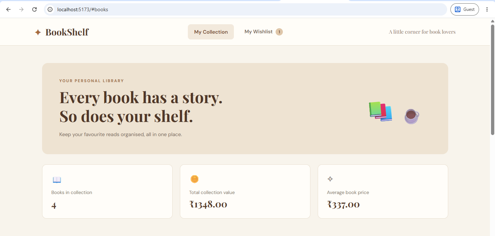
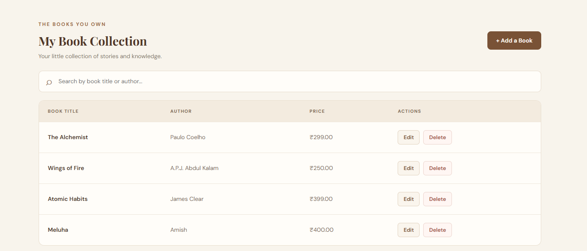
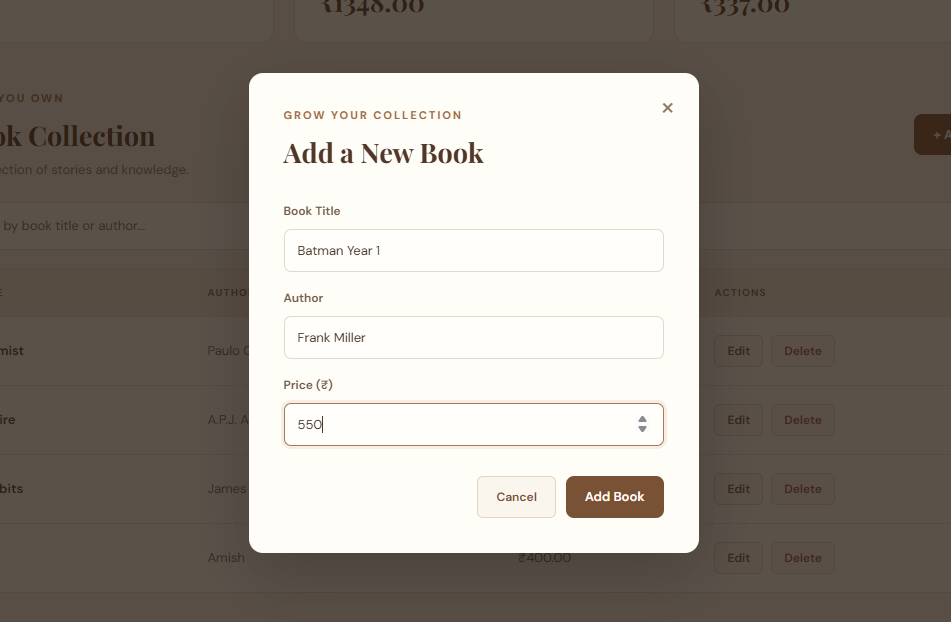
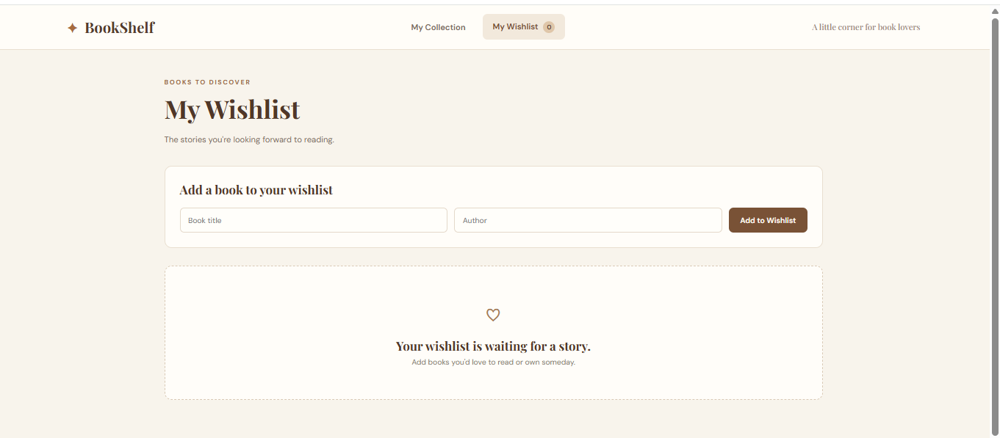
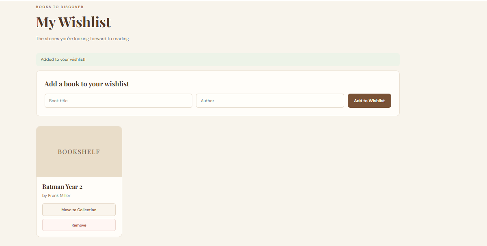

<div align="center">

# 📚 BookShelf – Online Book Management System

### Your personal corner for books, stories and discoveries.

A web-based book management application built using React.js, Node.js and Express.js.

<br>


</div>

---

## 📖 About the Project

**BookShelf** is an Online Book Management System developed to make managing a personal book collection simple and convenient.

The application allows users to add, view, update, delete and search for books. It also includes a Wishlist feature where users can save books they wish to read or purchase in the future.

The application has a warm bookstore-inspired design with a simple and user-friendly interface.

## ✨ Features

### 📚 Book Management
- View all books in the collection.
- Add new books with title, author and price.
- Update existing book details.
- Delete books from the collection.
- Search books by title or author.

### 📊 Dashboard
- Display total number of books.
- Calculate total collection value.
- Display average book price.

### ❤️ My Wishlist
- Add books to a personal wishlist.
- View wishlist books.
- Remove books from the wishlist.
- Move wishlist books into the main collection.
- Save wishlist data using browser Local Storage.

### 🎨 User Interface
- Warm bookstore-inspired theme.
- Horizontal navigation bar.
- Responsive layout.
- Clean and easy-to-use interface.

---

## 📸 Application Screenshots

### 1. Dashboard

The dashboard displays a welcome section and important book collection statistics.

<div align="center">
  
</div>

### 2. My Book Collection

View, search, edit and delete books from the collection.

<div align="center">
  
</div>

### 3. Add a New Book

Add a book by entering its title, author and price.

<div align="center">
  
</div>

### 4. My Wishlist – Empty State

A dedicated section to add books you wish to read or purchase.

<div align="center">
  
</div>

### 5. My Wishlist – With Books

View saved wishlist books and move them into the main collection.

<div align="center">
  
</div>

---

## 🛠️ Technologies Used

| Technology | Purpose |
|---|---|
| React.js | Frontend development |
| JavaScript | Application logic |
| HTML5 | Web page structure |
| CSS3 | Styling and responsive layout |
| Node.js | Backend runtime environment |
| Express.js | Backend and REST API development |
| Fetch API | Frontend and backend communication |
| Local Storage | Wishlist data storage |

---

## 📁 Project Structure

```text
OnlineBookManagement/
│
├── backend/
│   ├── server.js
│   ├── package.json
│   └── package-lock.json
│
├── frontend/
│   ├── src/
│   │   ├── App.jsx
│   │   ├── App.css
│   │   ├── index.css
│   │   └── main.jsx
│   ├── package.json
│   └── package-lock.json
│
├── Screenshots/
│   ├── dashboard.png
│   ├── dashboard1.png
│   ├── add_book.png
│   ├── wishlist.png
│   └── wishlist1.png
│
├── .gitignore
└── README.md
```

---

## ⚙️ Installation and Setup

### Prerequisites

Make sure the following are installed:

- Node.js
- npm
- Visual Studio Code (recommended)

### 1. Clone the Repository

```bash
git clone https://github.com/AnkithaDevadiga17/OnlineBookManagement.git
```

### 2. Navigate to the Project Directory

```bash
cd OnlineBookManagement
```

### 3. Set Up and Run the Backend

Open a terminal:

```bash
cd backend
npm install
node server.js
```

The backend server will run at:

`http://localhost:5000`

### 4. Set Up and Run the Frontend

Open a **second terminal**:

```bash
cd frontend
npm install
npm run dev
```

Open the local URL displayed in the terminal, usually:

`http://localhost:5173`

---

## 🔗 REST API Endpoints

The backend provides the following REST API endpoints:

| HTTP Method | Endpoint | Description |
|---|---|---|
| GET | `/books` | Retrieve all books |
| GET | `/books/:id` | Retrieve a particular book using its ID |
| POST | `/books` | Add a new book |
| PUT | `/books/:id` | Update existing book details |
| DELETE | `/books/:id` | Delete a book using its ID |

### Sample Book Data

```json
{
  "title": "The Alchemist",
  "author": "Paulo Coelho",
  "price": 299
}
```

---

## 🗄️ Data Storage

- Book details are maintained in an in-memory array in the Express.js backend.
- Wishlist details are stored in the browser using Local Storage.

**Note:** Book collection data resets when the backend server restarts because it uses in-memory storage. Wishlist data remains saved in the browser.

---

## 🎯 Project Objective

The objective of this project is to develop an Online Book Management System using Node.js and Express.js for backend development and React.js for the frontend.

The project demonstrates CRUD operations, REST API development, JSON middleware, Fetch API communication and dynamic rendering of book information.

---

## 👩‍💻 Developed By

<div align="center">

### Ankitha Devadiga

**Online Book Management System**

[GitHub Profile](https://github.com/AnkithaDevadiga17)

</div>

---

<div align="center">

📚 *Made with ❤️ for the love of books.*

</div>
